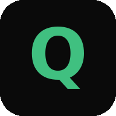
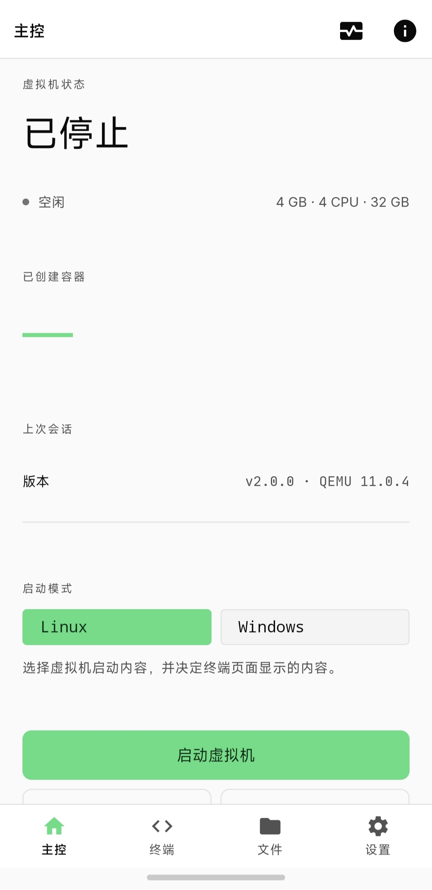
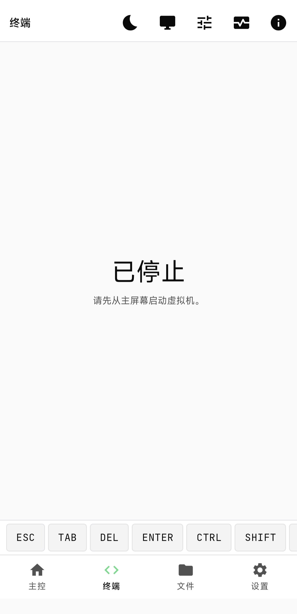
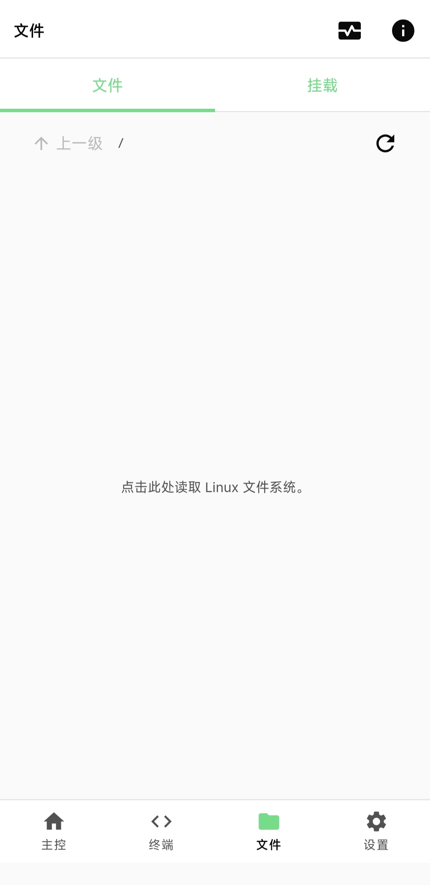
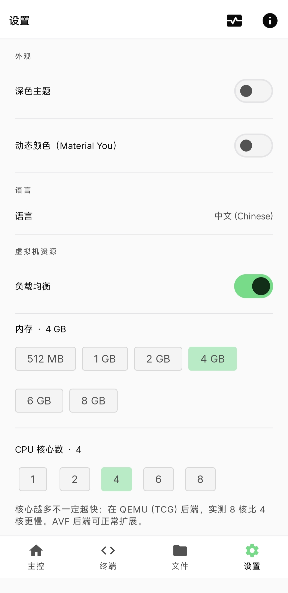

<p align="right">
  <a href="README.md">简体中文</a> · <b>English</b>
</p>

<div align="center">



# Qodroid

**Run real Linux and Windows virtual machines on your Android phone — no root required.**

Qodroid is a modified fork of [ExTV/Podroid](https://github.com/ExTV/Podroid) (GPL v2, package `com.pxkf.qodroid`) built on QEMU / AVF. It runs a real Alpine Linux VM with its own kernel on arm64 phones, and can boot Windows from your own x86 disk image.

[](LICENSE)


[**Download APK**](https://github.com/mf9593/Qodroid/releases/latest) · [**Website**](https://mf9593.github.io/Qodroid/) · [**Documentation**](https://mf9593.github.io/Qodroid/docs/guide/) · [**Upstream Podroid**](https://github.com/ExTV/Podroid)

</div>

## Screenshots

<table>
  <tr>
    <td align="center" width="50%">
      <br />
      <sub>Home: choose Linux or Windows and start the VM</sub>
    </td>
    <td align="center" width="50%">
      <br />
      <sub>Terminal: xterm-256color with a shortcut bar</sub>
    </td>
  </tr>
  <tr>
    <td align="center" width="50%">
      <br />
      <sub>Files: browse the Linux filesystem</sub>
    </td>
    <td align="center" width="50%">
      <br />
      <sub>Settings: theme, language, and VM resources</sub>
    </td>
  </tr>
</table>

<sub>Screenshots show the Chinese UI; English is available in the app.</sub>

## What is this?

Qodroid is a full virtual machine that runs on your Android phone — not a chroot, and not proot.

It is based on [ExTV/Podroid](https://github.com/ExTV/Podroid) (GPL v2, package `com.pxkf.qodroid`) and runs Alpine Linux with its own kernel on arm64 phones. Podman / Docker / LXC behave just like they do on a server, and you can boot a Windows VM from your own x86 disk image. A built-in terminal, X11 / VNC desktop viewer, and container management are ready out of the box.

## Features

- **A real Linux VM**: Alpine Linux with a custom kernel, `apk` package management, and persistent system and data.
- **Windows VM**: boot your own x86 disk image with q35 + OVMF/UEFI firmware and use the built-in VNC desktop viewer.
- **Two engines**: QEMU (TCG) on regular devices, with optional AVF hardware acceleration on devices that support pKVM.
- **Built-in terminal**: full xterm-256color, 100+ color themes and a range of monospace fonts, live resize, and a complete shortcut bar.
- **X11 / VNC desktop**: view Linux GUI apps inside the app with touch, trackpad, keyboard, mouse, and audio.
- **Containers out of the box**: Podman, Docker, and LXC are pre-installed; if podman is empty, Qodroid can fall back to docker automatically.
- **SSH, port forwarding, and USB passthrough**: SSH in from your computer, expose guest ports to the LAN, or pass through USB devices.
- **Sharing and backup**: mount the phone's Download folder inside the VM, and back up / restore containers and images.
- **Bilingual with offline docs**: built-in user guide, FAQ, and the full GPL v2 text, readable without a network connection.
- **No root**: works on arm64 devices running Android 8+, with no bootloader unlock or custom recovery.

<details>
<summary><b>What's new in Qodroid 2.0.0 compared with upstream</b></summary>

- **Windows VM support**: load x86 disk images directly, with q35 + OVMF/UEFI and a built-in VNC desktop viewer.
- **Windows boot optimizations**:
  - USB absolute pointing is enabled by default (`-usb -device usb-tablet`), so the cursor no longer drifts on touchscreens;
  - a VNC "expose to LAN" toggle was added; by default VNC listens only on `127.0.0.1`, and enabling the toggle lets other devices on the LAN connect;
  - the "auto-login Linux" option is hidden in Windows mode;
  - if Windows has no network access, set its adapter DNS manually to `8.8.8.8` / `223.5.5.5` (QEMU slirp's built-in DNS forwarding is unreliable on Android; `ping` fails because slirp does not forward ICMP, not because the network is down).
- **Container engine fallback**: automatically use docker when podman is empty (useful with 1Panel and similar tools whose containers live in docker); container backup supports both docker and podman and no longer depends on legacy guest scripts.
- **X11 / VNC viewer improvements**:
  - the bottom shortcut bar is aligned with the terminal, with `DEL` / `ENTER` / `SHIFT` / `PASTE` added;
  - a new `WIN` key sends the Win key and opens the Start menu with a single tap;
  - the default touch mode is now Trackpad, and the settings panel selects it by default.
- **Removed disk image backup**: backup / restore now uses container backup only, with no VM disk image export.
- **About page**: a new "Open source & licenses" section includes the full GPL v2 text and works offline.
- **Built-in docs**: the About page links to a user guide covering startup, containers, port forwarding, backups, and common questions.
- **Misc**: the gray hint on the Files page is centered; the changelog has its own page; the image-source dropdown shows the current value.

</details>

## Quick start

1. Download the latest APK from [Releases](https://github.com/mf9593/Qodroid/releases/latest).
2. Install and open Qodroid; on first install, allow installation from unknown sources.
3. Choose **Linux** or **Windows**, then tap **Start VM**.
4. Wait for the status to become **Ready**, then open the terminal.

> **Default credentials**: Linux user `root`, password `podroid`, SSH port `9922`. Changing the password will break in-app auto-login and file management, so do it with care.

```sh
# Containers work right away
podman run --rm alpine echo "hello from a container"
docker run -d -p 8080:80 nginx

# Port forwarding: TCP / UDP, on both QEMU and AVF backends
podroid-forward add 8080 8080 tcp
podroid-forward clean                # remove all port-forwarding rules

# SSH in from your computer
ssh root@<phone-ip> -p 9922
```

## Windows VM

- Boot your own x86 disk image with q35 + OVMF/UEFI firmware.
- USB absolute pointing is enabled by default, so the cursor no longer drifts on touchscreens.
- The desktop is shown in the built-in VNC viewer; VNC listens only on localhost by default, and can be exposed to the LAN when needed.
- The bottom shortcut bar includes `DEL` / `ENTER` / `WIN` / `F1`–`F12`.
- If Windows has no network access, set the adapter DNS manually to `8.8.8.8` / `223.5.5.5`.

> `ping` failing is normal: QEMU slirp does not forward ICMP. Open a web page to check connectivity instead.

## Build

Requires Docker, JDK, and the Android SDK / NDK.

```sh
git clone https://github.com/mf9593/Qodroid.git
cd Qodroid

./build-all.sh all     # kernel, rootfs, QEMU, and APK
./build-all.sh test    # run tests
```

See [CONTRIBUTING.md](CONTRIBUTING.md) for per-component builds and toolchain details.

## Project layout

| Directory | Purpose |
| --- | --- |
| `app/` | Android app: Compose UI, VM control, and settings |
| `terminal-emulator/` | Terminal emulator engine |
| `terminal-view/` | Terminal view component |
| `build-rootfs/` | Alpine rootfs build scripts |
| `build-tools/` | Build helper tools |
| `docs/`, `img/` | Documentation and screenshots |

## Docs and support

- In the app: **About → User guide** (bilingual and readable offline)
- Online: [Documentation](https://mf9593.github.io/Qodroid/docs/guide/)
- Bug reports: [GitHub Issues](https://github.com/mf9593/Qodroid/issues)

## Contributing

Contributions of every size are welcome: bug reports, kernel-config tweaks, new themes, UI polish, X11 input fixes, and more.

- **Pull requests**: read [CONTRIBUTING.md](CONTRIBUTING.md) first, keep changes scoped, run `./build-all.sh test` before pushing, and explain *why* in the PR description.
- **Bug reports**: include your device model, Android version, a short repro, and the diagnostic log (**Settings → Export Diagnostic Log** in the app).

## Credits

| Project | Used for |
| --- | --- |
| [QEMU](https://www.qemu.org) | Machine emulation |
| [Termux](https://github.com/termux/termux-app) | Terminal emulator engine |
| [Alpine Linux](https://alpinelinux.org) | Guest distribution |

Full list in [CREDITS.md](CREDITS.md).

## License

[GPL v2](LICENSE). Qodroid is based on [ExTV/Podroid](https://github.com/ExTV/Podroid); copyright belongs to the original authors and contributors. If this project is useful to you, a Star helps other people find it.

---

<p align="center">
  <a href="README.md">简体中文</a> · <b>English</b>
</p>
