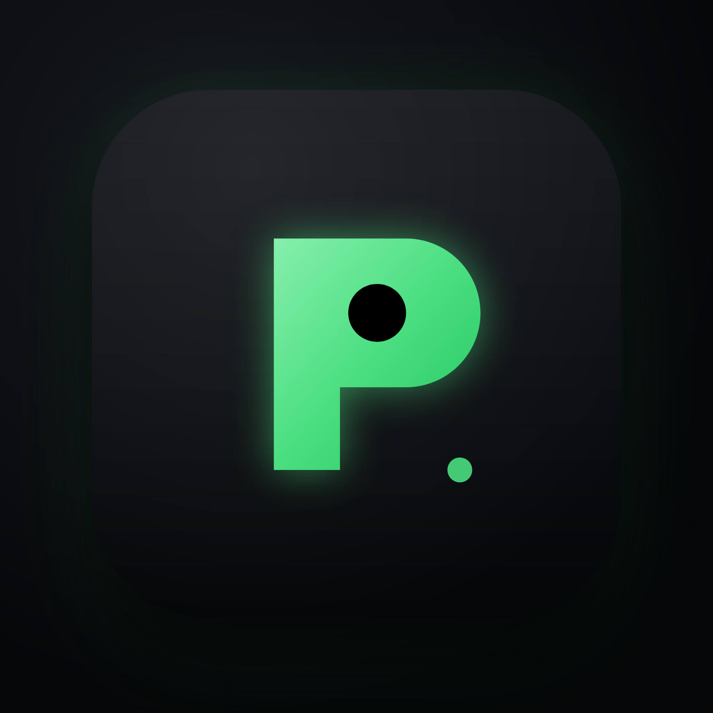

<div align="center">



# Qodroid

**在 Android 手机上运行 Linux 容器、Linux 桌面与 Windows 虚拟机，无需 root。**

Qodroid 是 [ExTV/Podroid](https://github.com/ExTV/Podroid) 的修改版（GPL v2），包名 `com.pxkf.qodroid`。同样基于 QEMU / AVF，提供真实的 Alpine Linux 虚拟机以及 x86 Windows 虚拟机支持。

[](LICENSE)


[**下载页**](https://mf9593.github.io/Qodroid/) · [**GitHub 仓库**](https://github.com/mf9593/Qodroid) · [**上游 Podroid**](https://github.com/ExTV/Podroid) · [**Release**](https://github.com/mf9593/Qodroid/releases)

</div>

## Qodroid 2.0.0 相比上游的主要改动（中文说明）

- **Windows 虚拟机支持**：可直接加载 x86 磁盘镜像，q35 + OVMF/UEFI，内置 VNC 桌面查看器。
- **Windows 启动优化**：
  - 默认启用 USB 绝对定位指针（`-usb -device usb-tablet`），触屏下鼠标不再漂移；
  - VNC 增加「暴露到局域网」开关，默认仅本机 `127.0.0.1`，开启后允许局域网其它设备连接；
  - Windows 模式下隐藏「自动登录 Linux」选项；
  - 若 Windows 无法联网，请在其网卡手动把 DNS 设为 `8.8.8.8` / `223.5.5.5`（QEMU slirp 的内置 DNS 在 Android 上转发不可靠；ping 不通是 slirp 不转发 ICMP 所致，不代表断网）。
- **容器引擎回落**：检测到 podman 为空时自动改用 docker（适配使用 1Panel 等管理工具、其容器位于 docker 的场景）；容器备份同时支持 docker 与 podman，不再依赖 guest 内的旧脚本目录。
- **X11 / VNC 查看器改进**：
  - 底部快捷键栏与终端对齐，补全 `DEL` / `ENTER` / `SHIFT` / `PASTE`；
  - 新增 `WIN` 键——单按发送 Win 键弹出开始菜单；
  - 默认触摸模式改为触摸板（Trackpad），设置面板默认选中同步。
- **移除磁盘镜像备份**：备份/恢复统一走容器备份，不再包含虚拟机磁盘镜像导出。
- **关于页**：新增「开源与许可证」区块，内置 GPL v2 全文，断网可见。
- **内置使用文档**：关于页可进入「使用文档」，涵盖启动、创建容器、端口转发、备份与常见问题。
- **其他**：文件页灰色提示居中；更新日志独立成页；镜像源下拉与当前值显示。

> 本仓库以「全新 git init」方式建立（不含上游提交历史），上游项目为 [ExTV/Podroid](https://github.com/ExTV/Podroid)，许可证 GPL v2，版权声明见 [LICENSE](LICENSE)。

## What you get (original)

- **Podman, Docker and LXC** - pre-installed, ready the moment it boots
- **A real VM** - Alpine Linux on a custom kernel via QEMU, or hardware-accelerated AVF on supported pKVM devices
- **In-app terminal** - full xterm-256color, 122 color themes, 13 fonts, live resize
- **X11 desktop** - run GUI Linux apps in a built-in viewer with touch, keyboard, mouse and audio
- **USB passthrough**, **SSH**, **port forwarding** and a **guest-to-Android bridge**
- **Container backup**, a **live VM/device status view** and **Downloads-folder sharing** with the guest
- **English and 中文**, no root, any arm64 device on Android 8+

## Quick start

1. [Download the APK](https://github.com/ExTV/Podroid/releases/latest) and install it.
2. Tap **Start VM**, wait for **Ready!**, open the terminal.

```sh
# rootless containers, straight away
podman run --rm alpine echo "hello from a container"
docker run -d -p 8080:80 nginx

# expose that container to your phone and LAN, right from the VM shell
podroid-forward add 8080 8080 tcp     # TCP or UDP, on both the QEMU and AVF backends
curl http://<phone-ip>:8080
podroid-forward clean                 # remove every rule you added, in one go

# SSH in from your laptop (enable SSH in the setup wizard or Settings)
ssh root@<phone-ip> -p 9922        # password: podroid
```

Setup, the two backends, networking, the X11 viewer and troubleshooting all live in the **[documentation](https://extv.github.io/Podroid/guide/)**.

## Build

```sh
git clone https://github.com/ExTV/Podroid.git
cd Podroid
./build-all.sh all     # kernel, rootfs, QEMU and APK (needs Docker + Android SDK/NDK)
```

Per-component builds and toolchain details: [CONTRIBUTING.md](CONTRIBUTING.md).

## Contributing

Contributions of every size are welcome: bug reports, kernel-config tweaks, new themes, UI polish, X11 input fixes, anything.

- **Pull requests:** read [CONTRIBUTING.md](CONTRIBUTING.md) first. Keep changes scoped, run `./build-all.sh test` before pushing, and explain *why* in the PR description.
- **Bug reports:** [open an issue](https://github.com/ExTV/Podroid/issues/new) with your device and Android version, a short repro, and the diagnostic log (**Settings → Export Diagnostic Log** in the app).

## Related projects

**[RikkaHub Agent](https://github.com/ExTV/rikkahub-agent)** is a fork of [RikkaHub](https://github.com/rikkahub/rikkahub), the native Android LLM chat client, that turns it into a real on-device agent: 80+ device tools, scheduled jobs, an AI-driven browser, a Linux workspace, SSH, screen automation and a remote Telegram bot, all opt-in. Its SSH tool can log into a running Podroid VM (`localhost:9922`), so an agent on your phone can build, run and inspect containers without you typing a command.

## Credits

| | |
|---|---|
| [QEMU](https://www.qemu.org)                   | Machine emulation |
| [Termux](https://github.com/termux/termux-app) | Terminal emulator engine |
| [Alpine Linux](https://alpinelinux.org)        | The guest distribution |

Full list in [CREDITS.md](CREDITS.md).

## License

[GPLv2](LICENSE). If Podroid is useful to you, a [star](https://github.com/ExTV/Podroid/stargazers) helps other people find it.
